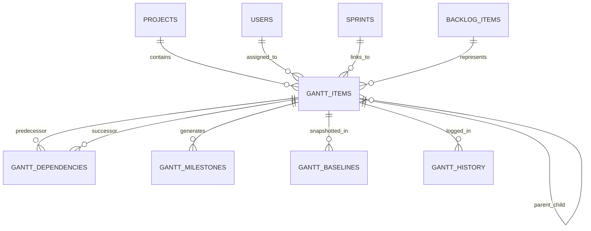

# PRD 20 — Gantt Chart & Timeline View: Reverse Engineering Report

**Date:** 2026-10-28  
**Author:** Antigravity (Senior Full-Stack Orchestrator)  
**Target:** Mahi Tech Group Unified Platform  
**Reference Specification:** [docs/20_GANTT_CHART_TIMELINE.md](file:///f:/UserData/Downloads/MAHI%20TECH%20GROUP/docs/20_GANTT_CHART_TIMELINE.md)  
**Status:** COMPLETED & SUBMITTED FOR REVIEW

---

## 1. Executive Summary

This report satisfies the mandatory **Reverse Engineering Mandate** set forth in PRD 20 before writing Layer 1 code. Five market-leading project timeline and Gantt systems were analyzed:
1. **Monday.com** (Fluid timeline, drag-resize bars, flexible groupings, critical path calculation)
2. **Asana** (Timeline view, strict/fluid dependencies, milestone diamonds, portfolio timelines)
3. **ClickUp** (Gantt view, multi-type dependency lines, baselining, schedule recalculation)
4. **Jira** (Roadmap/Timeline, epic hierarchy, sprint-aligned scheduling, release fix versions)
5. **Smartsheet** (Classical waterfall Gantt, predecessor notation, % complete shading, auto-scheduling)

All proprietary branding, UI skins, typography, color palettes, and marketing copy have been strictly discarded. The underlying mathematical and relational foundations — topological task graphs, dependency constraints, duration calculations, critical path CPM algorithms, and baseline variance accounting — have been synthesized and re-architected natively for the Mahi Tech Group stack (Node.js, SQLite WAL, Express 5, Vanilla CSS / SVG rendering).

---

## 2. Competitor Breakdown & Flow Analysis

| Competitor | Core Timeline Flow | Dependency Model | Milestone Handling | Baselining & History |
| :--- | :--- | :--- | :--- | :--- |
| **Monday.com** | Grid-to-timeline hybrid; items plotted by Date Column; drag-to-shift and drag-to-resize updates column. | Links items via Dependency Column; supports Flexible, Strict, and No-overlap auto-shifting. | Milestones represented as single-date starred items or zero-duration markers. | Activity log per board row; baseline requires Enterprise feature add-on. |
| **Asana** | Timeline lane view; items arranged into sections; direct drag-and-drop on SVG bar connectors. | Visual connector pins drawn from bar end to bar start; warns or auto-shifts dependent dates. | Explicit milestone task type (diamond glyph); triggers celebratory banner on completion. | Audit trail in task story comments; portfolio progress snapshotting. |
| **ClickUp** | Highly customizable Gantt canvas with zoom levels (Day to Year); auto-scheduling toggle. | 4 standard dependency types: FS, SS, FF, SF; visual arrows with color-coded conflict warnings. | Diamond milestone flag; milestones can have subtasks or linked checklists. | Snapshot baseline comparisons showing ghost/shadow bars beneath active schedules. |
| **Jira** | Hierarchy-first (Epic → Story → Subtask); bars snap to sprint boundaries or explicit dates. | Issue link types (`blocks` / `is blocked by`); dependency map shows cross-team risks. | Release / Version markers plotted vertically across the entire roadmap. | Change history logged in `changeitem` table; baseline requires Advanced Roadmaps. |
| **Smartsheet** | Spreadsheet row + Gantt chart split; predecessor formula syntax (e.g. `3FS+2d`). | Strict waterfall predecessors with lag/lead time support; automatic critical path highlight. | Zero-duration rows automatically convert into milestone diamonds. | Baseline snapshots with variance columns showing planned vs actual variance in days. |

---

## 3. Screen & View Mapping

In competitor ecosystems, Gantt and timeline functionality spans several core interfaces:
1. **Interactive Gantt Canvas (Main View):**
   - Split pane or full canvas: Left pane displays hierarchical task table (Title, Assignee, Dates, Progress %), Right pane displays horizontal timeline grid with date headers.
   - Draggable task bars with duration resizing grips on left/right edges.
   - SVG dependency connector lines linking predecessor bar ends to successor bar starts.
   - Today indicator: Prominent vertical rule positioned at the current calendar date.
   - Zoom scale toggles: Day, Week, Month, Quarter.
2. **Task & Dependency Detail Sidebar / Modal:**
   - Quick inspection of item metadata (title, dates, status, assignee, color).
   - Inbound and outbound dependency lists with lag settings and remove actions.
   - Append-only audit history log showing past date and progress shifts.
3. **Milestone Timeline / Deliverable Tracker:**
   - Chronological summary of pivotal anchor dates without task clutter.
   - Quick one-click "Mark Achieved" action with timestamping.
4. **Baseline Comparison (Planned vs Actual):**
   - Dual-bar overlay: Baseline bar (planned schedule snapshot) displayed alongside or beneath current live task bar.
   - Schedule slip quantification (e.g., "+3 days slip", "-1 day ahead").

---

## 4. Data Relationships & Schema Synthesis

To model the full graph without external heavyweight libraries, the relationship schema is designed as follows:

### Key Relational Rules:
- **Task Hierarchy:** `parent_item_id` self-references `gantt_items(id)` (allows Phase → Task → Subtask hierarchy).
- **Directed Graph (Dependencies):** `gantt_dependencies` links `predecessor_item_id` to `successor_item_id` with `dependency_type` (`FINISH_TO_START`, `START_TO_START`, `FINISH_TO_FINISH`, `START_TO_FINISH`) and `lag_days`.
- **Milestone Anchors:** `gantt_milestones` tracks high-level achievements either linked to a specific `gantt_item` or standalone at project level.
- **Append-Only Auditing & Snapshots:** `gantt_baselines` captures immutable snapshots of planned timelines (`baseline_start_date`, `baseline_end_date`). `gantt_history` logs immutable field audit diffs.

---

## 5. Business Rules & Logic Mapping

From studying Asana, ClickUp, and Smartsheet, we identified the essential business rules:

1. **Chronological Validity:**
   - `end_date >= start_date` for any task or phase.
   - For `MILESTONE` types, `start_date === end_date` (zero-duration point).
2. **Topological Invariant (No Circular Dependencies):**
   - The dependency graph must be a **Directed Acyclic Graph (DAG)**.
   - Before inserting any dependency edge $A \rightarrow B$, the system must verify that no path exists from $B \rightarrow A$ using Depth-First Search (DFS) / Breadth-First Search (BFS).
3. **Dependency Conflict Detection:**
   - In a `FINISH_TO_START` dependency with `lag_days`, the constraint is:
     $$\text{Successor.start\_date} \ge \text{Predecessor.end\_date} + \text{lag\_days}$$
   - When predecessor dates shift, rather than destructively rewriting successor schedules without human intent, the system generates conflict alerts.
4. **Critical Path Method (CPM):**
   - Calculate Forward Pass (Early Start, Early Finish) and Backward Pass (Late Start, Late Finish).
   - Items with Total Float / Slack $= 0$ represent the Critical Path.
   - Critical path bars are flagged for visual priority (preventing project delivery slippage).
5. **Append-Only Security Invariant:**
   - Baseline snapshots cannot be updated or deleted (DB triggers enforce this).
   - History logs cannot be modified or deleted.
   - Dependency deletions insert reversal audit events rather than mutating historical records.

---

## 6. What We Will NOT Copy vs What We Will Rebuild Our Own Way

### What We Will NOT Copy:
- ❌ **No Proprietary UI/Branding:** No Monday.com pastel boards, no Asana peach/coral accent buttons, no ClickUp purple menus, no Jira issue badges.
- ❌ **No Proprietary Micro-copy:** Avoid competitor terms like "Pulse", "Board View", "Portfolio Rollup", "Smart Predict".
- ❌ **No Heavy Commercial Canvas Libraries:** No Bryntum Gantt, DHTMLX Gantt, or Frappe Gantt commercial packages with licensing traps or tracking scripts.
- ❌ **No Disruptive Auto-Cascading:** Avoid automatic blind date pushes that break team commitments without confirmation.

### What We WILL Reverse-Engineer & Rebuild Our Own Way:
- ✅ **Native SVG Timeline Rendering:** Lightweight, zero-dependency browser SVG canvas rendering task bars, progress fill, and Bezier connector lines.
- ✅ **Server-Side DAG & CPM Engine:** Pure JavaScript graph traversal for topological sorting, cycle detection, and critical path calculation.
- ✅ **Append-Only Immutability:** SQLite trigger-enforced protection for baselines, dependencies, and audit history.
- ✅ **Seamless Pipeline & Sprint Integration:** Direct optional linkages to Mahi Tech Group's existing PRD 15 (Pipeline), PRD 18 (Sprint Backlog), and PRD 19 (OKRs).

---

## 7. Gaps & Opportunities Identified (How We Will Be Better)

1. **Integrated OKR & Sprint Coherence:** Competitors treat Gantt charts as isolated views. Mahi Tech Group will allow any Gantt item to tie directly back to an OKR Key Result or Sprint Backlog Item.
2. **Immutable Audit Trail by Default:** In Jira or Monday, admins can delete or edit baselines. In Mahi Tech Group, DB triggers make baselines and history strictly append-only.
3. **Non-destructive Schedule Warning:** Rather than silently breaking predecessor logic or unpredictably sliding deadlines, our system provides precise date conflict warnings.
4. **Zero Bloat & Instant Loading:** Unlike web-heavy React/Webpack timeline bundles exceeding 5MB, our native SVG implementation will render instantly.

---

## 8. Layer 1 Implementation Plan Confirmation

With reverse engineering fully documented, Layer 1 scope is strictly defined:
- **Tables (5):** `gantt_items`, `gantt_dependencies`, `gantt_milestones`, `gantt_baselines`, `gantt_history`.
- **Triggers (6):** `prevent_gantt_dependency_update`, `prevent_gantt_dependency_delete`, `prevent_gantt_baseline_update`, `prevent_gantt_baseline_delete`, `prevent_gantt_history_update`, `prevent_gantt_history_delete`.
- **Indexes:** High-performance composite indexes on project, item, and user foreign keys.
- **Verification:** Dedicated test script `scripts/verify-prd20-layer1.js` proving table definitions and trigger abort violations under real SQLite operations.
