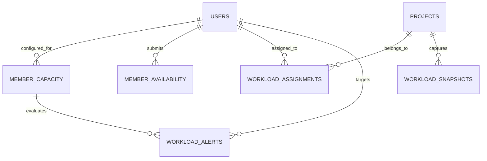

# PRD 21 — Resource Workload Dashboard: Reverse Engineering Report

**Date:** 2026-10-28  
**Author:** Antigravity (Senior Full-Stack Orchestrator)  
**Target:** Mahi Tech Group Unified Platform  
**Reference Specification:** [docs/21_RESOURCE_WORKLOAD_DASHBOARD.md](file:///f:/UserData/Downloads/MAHI%20TECH%20GROUP/docs/21_RESOURCE_WORKLOAD_DASHBOARD.md)  
**Status:** COMPLETED & SUBMITTED FOR REVIEW

---

## 1. Executive Summary

This report satisfies the mandatory **Reverse Engineering Mandate** set forth in PRD 21 before writing Layer 1 code. Five market-leading resource management, capacity planning, and workload allocation systems were analyzed:
1. **Monday.com** (Workload view, individual weekly capacity thresholds, bubble visualizer, color-coded overload badges)
2. **Wrike** (Resource management grid, capacity planning, workload heatmap, scheduled vs actual effort)
3. **Asana** (Workload lane view, tasks/hours per person per week, custom capacity limit settings, re-balancing drawers)
4. **ClickUp** (Workload view, story points / estimated hours per member per sprint, capacity bars, time off integration)
5. **Teamwork** (Resource scheduling matrix, availability calendar, planned utilization %, leave management)

All commercial styling, branding, proprietary copy, and subscription paywall mechanics have been strictly discarded. The underlying mathematical and relational foundations — member capacity modeling, time-off/leave availability deductions, multi-week task proration, utilization % metrics, and append-only audit alerts — have been synthesized and re-architected natively for the Mahi Tech Group stack (Node.js, SQLite WAL, Express 5, Vanilla CSS / DOM rendering).

---

## 2. Competitor Breakdown & Flow Analysis

| Competitor | Core Workload Flow | Capacity & Availability Model | Overload Detection & Thresholds | Workload Balancing & Actions |
| :--- | :--- | :--- | :--- | :--- |
| **Monday.com** | Horizontal timeline rows per member with circular capacity bubbles showing assigned vs max effort. | Fixed weekly hours per person or item count; integrates with working days calendar. | Overloaded bubbles turn bright red when assigned work exceeds weekly threshold; blue/green when within capacity. | Click bubble to view assigned tasks list; drag items to another person's row to rebalance. |
| **Wrike** | Daily/weekly grid showing allocated hours per team member across concurrent projects. | Work schedules define standard working hours (e.g. 40h/wk) and national/company holidays. | Heatmap cells change color intensity (low = light blue, optimal = green, overloaded = red gradient). | Drag task edges to lengthen duration (reducing daily load) or reassign to an underutilized peer. |
| **Asana** | Capacity trend line per member spanning 1–4 weeks; tasks displayed as horizontal bars or point totals. | Custom capacity settings (hours or points per week); member account sets vacation/out-of-office dates. | Red warning indicators and trend lines bursting through capacity ceiling when load > 100%. | Direct drag-and-drop task reassignment from overloaded member lane to underloaded teammate lane. |
| **ClickUp** | Sprint-based or calendar-based workload bar per assignee with percentage or numerical hour meters. | Assignee weekly capacity in hours or points; integrates with native time-off tracking. | Over capacity bar fills solid red with percentage (e.g. 140%); near capacity turns amber (85–100%). | "Split task" or reassign to available team member with lowest current utilization. |
| **Teamwork** | Resource scheduling calendar mapping confirmed project allocations against total team bandwidth. | Daily/weekly capacity per member with explicit leave requests (Vacation, Sick Leave, Training). | Utilization percentage calculated: $(Allocated \div Available) \times 100$; flags overbooked staff. | Quick reassignment modal with auto-suggested members who have matching role and free capacity. |

---

## 3. Screen & View Mapping

Across competitor systems, resource workload functionality converges on 4 core operational interfaces:
1. **Team Workload Dashboard (Main Operational View):**
   - High-level overview of all team members for a selected time window (current week, previous, next).
   - Columns: Member identity, role, assigned hours, available capacity hours, utilization percentage, and color-coded status badge (`UNDERLOADED`, `OPTIMAL`, `NEAR_CAPACITY`, `OVERLOADED`).
   - Summary KPI tiles at top: Total Team Members, Overloaded Count, Optimal Count, Underloaded Count.
   - Quick action for Admins: 1-click "Reassign" on overloaded members.
2. **Workload Heatmap (Multi-Week Matrix):**
   - Matrix grid: Rows represent team members, Columns represent future weeks (next 8 weeks).
   - Color-coded cells showing utilization intensity.
   - Interactive inspection: Hover reveals task titles contributing to that week's allocation; clicking cell opens member week detail.
3. **My Workload (Individual Member Perspective):**
   - Privacy-isolated personal workspace: Members see only their own assignments and bandwidth.
   - Breakdown of assigned tasks for the active week with individual estimated hours.
   - 4-week lookahead bar chart showing upcoming workload distribution.
   - Self-service availability submission: "Mark Availability" button allowing members to request planned leaves or partial days.
4. **Capacity & Availability Planning (Admin Configuration Zone):**
   - Roster of all organization members with current weekly capacity settings (`weekly_capacity_hrs`).
   - Historical audit list of capacity revisions (who changed what and when).
   - Team availability calendar displaying approved leaves and blocked days.
   - Central alert center listing active capacity breaches and unacknowledged overload alerts.

---

## 4. Data Relationships & Schema Synthesis

To model workload and capacity cleanly within our relational SQLite architecture, the schema links seamlessly to existing projects, users, backlog items, and Gantt items:

### Key Relational Rules:
- **`member_capacity` (Append-Only):**
  - Stores `user_id`, `weekly_capacity_hrs` (default 40.0), `effective_from`, `effective_to` (NULL = active), and `set_by`.
  - Enforces append-only integrity via SQLite triggers (`prevent_capacity_update`, `prevent_capacity_delete`). Revisions insert a new active record rather than mutating past records.
- **`member_availability`:**
  - Stores `user_id`, `date`, `availability_type` (`LEAVE`, `HOLIDAY`, `PARTIAL`, `TRAINING`), `available_hrs` (0.0 = full day off), and `approved_by`.
  - Unique constraint on `(user_id, date)` ensures zero double-booking of leaves.
- **`workload_assignments`:**
  - Central aggregation hub capturing assigned work from all platform sources (`BACKLOG_ITEM`, `GANTT_ITEM`, `PIPELINE_POINT`, `MANUAL`).
  - Stores `title`, `estimated_hrs`, `start_date`, `end_date`, and `status` (`ACTIVE`, `COMPLETED`, `CANCELLED`).
- **`workload_snapshots` (Append-Only):**
  - Freezes point-in-time workload distributions as raw JSON for audits and reporting.
  - Enforces append-only triggers (`prevent_workload_snapshot_update`, `prevent_workload_snapshot_delete`).
- **`workload_alerts` (Append-Only with Acknowledge Exception):**
  - Logs system-generated alerts when utilization breaches critical thresholds ($>100\%$ or $<30\%$).
  - Delete trigger prevents record destruction; updates are restricted to `acknowledged_by` and `acknowledged_at`.

---

## 5. Mathematical & Business Rules Mapping

From analyzing Asana, ClickUp, and Wrike, we formulated mathematical formulations for utilization and capacity:

1. **Available Weekly Hours Formulation:**
   $$\text{AvailableHrs}_{w} = \text{WeeklyCapacityHrs} - \sum \text{HoursLostToLeave}_{w}$$
   Where $\text{HoursLostToLeave} = \text{StandardDailyHrs} - \text{AvailableHrs}$ for each availability entry falling within the 7-day calendar window of week $w$.

2. **Multi-Week Assignment Proration Formulation:**
   When an active assignment spans multiple weeks, its effort is prorated uniformly across working calendar days:
   $$\text{OverlapDays} = \max\left(0, \min(\text{Assignment.end\_date}, \text{Week.end\_date}) - \max(\text{Assignment.start\_date}, \text{Week.start\_date}) + 1\right)$$
   $$\text{TotalDurationDays} = \text{Assignment.end\_date} - \text{Assignment.start\_date} + 1$$
   $$\text{ProratedHrs}_{w} = \left(\frac{\text{OverlapDays}}{\text{TotalDurationDays}}\right) \times \text{estimated\_hrs}$$

3. **Utilization Percentage:**
   $$\text{UtilizationPct}_{w} = \left(\frac{\sum \text{ProratedHrs}_{w}}{\text{AvailableHrs}_{w}}\right) \times 100$$

4. **Deterministic Status Classification:**
   - $\text{UtilizationPct} < 50\% \implies \text{UNDERLOADED (Blue)}$
   - $50\% \le \text{UtilizationPct} \le 85\% \implies \text{OPTIMAL (Green)}$
   - $86\% \le \text{UtilizationPct} \le 100\% \implies \text{NEAR\_CAPACITY (Yellow)}$
   - $\text{UtilizationPct} > 100\% \implies \text{OVERLOADED (Red)}$

5. **Server-Side Enforcement & RBAC:**
   - Calculations occur 100% server-side in `workloadService.js`. Clients never supply pre-computed utilization figures.
   - Non-admin members receive **only** their own workload data. Team dashboards, company heatmaps, and peer capacity configurations are completely blocked from member-role JWTs.
   - Members can submit availability only for future dates; past date modifications require Admin privileges.

---

## 6. What We Will NOT Copy vs What We Will Rebuild Our Own Way

### What We Will NOT Copy:
- ❌ **No Proprietary UI/Branding:** No Monday.com bubbly pastel rings, no Asana peach highlight bars, no ClickUp purple meters, no Wrike complex multi-layered menus.
- ❌ **No Heavy Commercial Heatmap Widgets:** No licensed D3/Chart.js proprietary addons.
- ❌ **No Arbitrary Paywalls:** In commercial platforms, workload views require Enterprise or Business tiers ($25+/user/mo). In Mahi Tech Group, full capacity planning is native and unmetered.
- ❌ **No Client-Side Calculation Glitches:** Competitors frequently suffer from timezone mismatch and client-side rounding bugs. All proration in our engine is calculated server-side in UTC ISO calendar days.

### What We WILL Reverse-Engineer & Rebuild Our Own Way:
- ✅ **Native Lightweight DOM Heatmap:** Semantic CSS grid rendering 8-week utilization cells with responsive tooltips and zero external library dependencies.
- ✅ **Append-Only Capacity History:** Complete corporate governance tracking past capacity adjustments with immutable SQLite triggers.
- ✅ **Multi-Source Unified Aggregation:** Seamlessly aggregates tasks originating from Backlog Items (PRD 18), Gantt Timeline Items (PRD 20), and Pipeline Checklist Points (PRD 15).
- ✅ **Proactive Alert Engine:** Automatically detects overloads and underloads on every task assignment, generating actionable admin alerts.

---

## 7. Gaps & Opportunities Identified (How We Will Be Better)

1. **Unified Source of Truth:** In competing suites, backlog tasks, Gantt tasks, and ad-hoc operational tasks live in disconnected silos. Our `workload_assignments` engine normalizes all sources into a single queryable plane.
2. **True Immutability & Auditability:** Unlike competitors where historical workload logs can be erased by administrators, our SQLite triggers ensure append-only auditability for capacity changes and historical snapshots.
3. **Prorated Mathematical Accuracy:** Clear, verifiable calendar-day proration prevents artificial workload spikes on multi-week initiatives.
4. **Instant Offline-First Performance:** Built on Node.js and SQLite WAL mode, eliminating the sluggish 3–5 second load times typical of heavy enterprise workload pages.

---

## 8. Layer 1 Implementation Plan Confirmation

With reverse engineering fully documented, Layer 1 scope is strictly defined:
- **Tables (5):** `member_capacity`, `member_availability`, `workload_assignments`, `workload_snapshots`, `workload_alerts`.
- **Triggers (5):** `prevent_capacity_update`, `prevent_capacity_delete`, `prevent_workload_snapshot_update`, `prevent_workload_snapshot_delete`, `prevent_workload_alert_delete`.
- **Indexes (11):** Composite indexes covering `user_id`, `project_id`, `date`, `effective_from`, `week_start_date`, and `status`.
- **Verification:** Dedicated test script `scripts/verify-prd21-layer1.js` proving table schemas and trigger abort violations under real SQLite operations.
